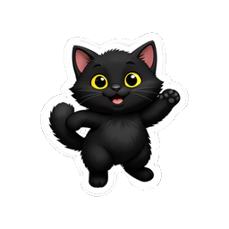
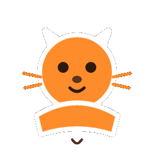

# GIF stickers

Describe a sticker in a normal Slack message:

> @bot make a happy cat doing a little dance as a GIF sticker

With the optional local artwork server, the model calls `generate_sticker_art` through Agentic API's native MCP support. ComfyUI generates polished artwork using FLUX.2 Klein 4B. The model polls `sticker_art_status`, then calls the local `create_sticker` function with the returned image ID. The app isolates the subject, adds a white outline, animates the cutout, and attaches a small looping GIF in the same thread.

Without the artwork server, the original SVG drawing mode remains available. It produces simpler illustrations whose quality depends on the language model's drawing ability. No paid image API is required for either mode; self-hosting uses your own compute.

## Install and run the artwork server

The provided setup uses CPU execution so it can coexist with GPU model servers. Install [uv](https://docs.astral.sh/uv/getting-started/installation/) first, then:

```bash
npm run sticker:install:art
tmux new -s meow-sticker-art
npm run sticker:serve
```

The installer creates an isolated Python 3.12 environment, installs CPU PyTorch, ComfyUI and the MCP SDK, and downloads approximately 16 GB of artwork models plus the subject-cutout model. Allow at least 32 GB of available RAM and sufficient disk space. CPU generation takes considerably longer than GPU inference; a measured 512-pixel test on the development host took 86 seconds, not a portable performance guarantee.

The launcher runs both services and shuts them down together:

- ComfyUI: `http://127.0.0.1:8188`
- Sticker MCP: `http://127.0.0.1:8189/mcp`

Set `STICKER_MCP_LABEL=sticker_art` in `.env`, then restart the combined Slack/gateway launcher. It registers the loopback MCP URL under `[mcp_servers.sticker_art]` in `$AGENTIC_API_HOME/config.toml`, allowing only `generate_sticker_art` and `sticker_art_status`. This is a narrow adapter included in this repository, not the broader Comfy-Org MCP server. It cannot accept arbitrary workflows or model paths from chat.

Each generation returns a job ID immediately; status calls wait at most 50 seconds, within the gateway's MCP call deadline. The queue allows at most three running/pending jobs. Artifacts are private local files under `.runtime/sticker-art`, and job handles expire after one hour. Expiration does not delete files: apply your own retention policy to that directory and ComfyUI's output directory. Cancelling a Slack response stops waiting but does not interrupt a shared ComfyUI generation already queued.

For cutouts alone, run `npm run sticker:install`. No ComfyUI server is needed to turn an uploaded image into an animated sticker.

## Turn an image into a sticker

Attach a PNG, JPEG, GIF or WebP in the same Slack message:

> @bot turn this image into a bouncing sticker, keep the transparent background

The model receives the image and its request-scoped ID (`image_1`, etc.), then calls `create_sticker` with the short prompt and `source_image`. The app preserves the image pixels, resizes the subject, adds a white outline, and animates it with **bounce**, **wiggle**, **pulse**, **float** or **spin**. It uses the first frame of an animated upload.

`background: auto` uses local rembg/IS-Net segmentation for photos and generated art. `keep` preserves existing transparency; `solid` removes an edge-connected plain color. Segmentation can miss fine details or difficult subjects; a transparent source with `keep` gives you control over the cutout. A vision-capable served model is required to interpret an attached image. Inputs are limited to 20 MB and 16 megapixels, as well as the app's attachment limits.

The function accepts only attachment IDs or trusted artwork IDs received during the current request. Reattach an image for later edits. It cannot fetch a URL or open a path supplied by the model. Users need both `readUploads` and `createFiles` to create stickers from attachments. Animation transforms the cutout; it is not generative video or new body poses.

Example function arguments:

```json
{
  "filename": "cat-bounce.gif",
  "prompt": "Make this cat bounce",
  "source_image": {"id": "image_1", "motion": "bounce", "background": "keep"},
  "frames": null
}
```

## Output

- 256 × 256 pixels, with transparency; fully opaque frames are rejected.
- Drawn stickers use 2–12 frames, 60–500 ms per frame, at most 3 seconds per loop. Image animations start with 20 frames over 1.2 seconds; detailed art may use 8–12 frames to meet the size budget while retaining the same duration.
- At most 256 KB per GIF; at most two stickers per reply, also subject to file limits.
- A complete first frame, clear silhouette, white outer border and seamless loop are requested from the model.

Slack controls the displayed attachment size. The function creates a downloadable file; it does not install a workspace emoji or contact WhatsApp. GIF supports one-bit transparency, so soft translucent edges are reduced to transparent or opaque pixels.

## Access and configuration

`STICKERS_ENABLED=true` enables the function for roles with `createFiles:true`. Set it to `false` to disable it globally. Viewers do not receive the tool. The bot needs Slack `files:write`, already included in the manifest.

The renderer uses `@resvg/resvg-js`, `sharp`/libvips GIF encoding, and strict XML validation. It crops transparent margins, renders at double resolution for smoother contours, and uses palette optimization, dithering and frame compression. Install platform dependencies with `npm ci` (or `npm ci --ignore-scripts` when you do not want the optional Chromium download). Do not omit optional platform packages if you want sticker rendering.

Model-drawn SVG accepts only basic shapes and text. Scripts, external resources, embedded images, styles, document types and file paths are rejected. Trusted raster animation is assembled internally. Rendering has a 30-second timeout; optional segmentation has a separate 90-second timeout. Both support cancellation. Steering during a pending local function handoff is not supported; send a new request with the updated description. Function results return to Agentic API over the existing WebSocket; GIF bytes stay in the Slack bridge and are uploaded to the requesting thread.

Third-party components run separately or as dependencies: [ComfyUI](https://github.com/Comfy-Org/ComfyUI) is GPL-3.0, [FLUX.2 Klein 4B](https://huggingface.co/black-forest-labs/FLUX.2-klein-4B) is Apache-2.0, and [rembg](https://github.com/danielgatis/rembg) is MIT. Review their terms when redistributing installations or model weights.

## How this compares with WhatsApp

WhatsApp's native animated stickers are transparent **WebP**, exactly **512 × 512**, at most **500 KB**, with frames of at least **8 ms** and a total duration of at most **10 seconds**. Its guide recommends a white outline and a first frame that remains meaningful when animation stops. See the [official WhatsApp sticker guide](https://github.com/WhatsApp/stickers/blob/main/Android/README.md#sticker-art-and-app-requirements).

This app follows those visual conventions but produces the smaller GIF requested for Slack. It does not claim WhatsApp import compatibility. Native WhatsApp creation involves rendering the artwork, encoding and compressing animated WebP, and importing it through a sticker maker or pack; see [WhatsApp's creation guide](https://faq.whatsapp.com/1056840314992666/?cms_platform=android).

## Try it without Slack

With your gateway/model configured in `.env`, run:

```bash
npm run sticker:smoke -- "a happy orange cat dancing"
npm run sticker:smoke -- --image ./cat.png "make this cat wiggle"
# Full Agentic API → MCP → ComfyUI → cutout → GIF flow:
npm run sticker:smoke -- --art "a fluffy black cat with yellow eyes celebrating"
```

This calls the real model and saves the GIF under `.runtime/sticker-smoke/`. It does not post anything to Slack.

## Generated examples

ComfyUI artwork with local subject cutout and bounce animation (221 KB):



Text prompt output, generated with the local Qwen model:



Image-plus-prompt output using the same cat as its source:


