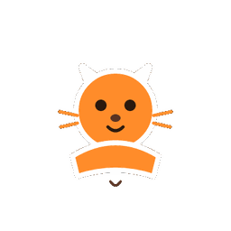

# GIF stickers

Describe a sticker in a normal Slack message:

> @bot make a happy cat doing a little dance as a GIF sticker

For a text prompt, the model designs consistent vector frames and calls the local `create_sticker` function. The app validates the artwork, renders it in a worker, and attaches a looping GIF to the same Slack thread. No separate image-generation account or key is needed. This produces simple illustrated artwork; quality depends on the served model's drawing and tool-calling ability.

## Turn an image into a sticker

Attach a PNG, JPEG, GIF or WebP in the same Slack message:

> @bot turn this image into a bouncing sticker, keep the transparent background

The model receives the image and its request-scoped ID (`image_1`, etc.), then calls `create_sticker` with the short prompt and `source_image`. The app preserves the image pixels, resizes the subject, adds a white outline, and animates it with **bounce**, **wiggle**, **pulse**, **float** or **spin**. It uses the first frame of an animated upload.

`background: keep` preserves existing transparency. `background: solid` removes edge-connected color matching a corner, which suits flat backgrounds. It is not general portrait/scene segmentation; upload a transparent cutout for complex photos. A vision-capable served model is required to interpret the image. Inputs are limited to 20 MB and 16 megapixels, as well as the app's attachment limits.

The function accepts only IDs of images attached to the current request. Reattach an image for later edits. It cannot fetch a URL or open a path supplied by the model. Users need both `readUploads` and `createFiles` to create stickers from attachments.

Example function arguments:

```json
{
  "filename": "cat-bounce.gif",
  "prompt": "Make this cat bounce",
  "source_image": {"id": "image_1", "motion": "bounce", "background": "keep"},
  "frames": null
}
```

## Output

- 256 × 256 pixels, with transparency; fully opaque frames are rejected.
- Drawn stickers use 2–12 frames, 60–500 ms per frame, at most 3 seconds per loop. Image animations use 12 frames over 1.2 seconds.
- At most 256 KB per GIF; at most two stickers per reply, also subject to file limits.
- A complete first frame, clear silhouette, white outer border and seamless loop are requested from the model.

Slack controls the displayed attachment size. The function creates a downloadable file; it does not install a workspace emoji or contact WhatsApp. GIF supports one-bit transparency, so soft translucent edges are reduced to transparent or opaque pixels.

## Access and configuration

`STICKERS_ENABLED=true` enables the function for roles with `createFiles:true`. Set it to `false` to disable it globally. Viewers do not receive the tool. The bot needs Slack `files:write`, already included in the manifest.

The renderer uses `@resvg/resvg-js`, `sharp`, `gifenc` and strict XML validation. Install platform dependencies with `npm ci` (or `npm ci --ignore-scripts` when you do not want the optional Chromium download). Do not omit optional platform packages if you want sticker rendering.

Only basic SVG shapes and text are accepted. Scripts, external resources, embedded images, styles, document types and file paths are rejected. Rendering has a 15-second timeout and supports cancellation. The model can correct invalid frames using the returned tool error. Steering during a pending local function handoff is not supported; send a new request with the updated description. Function results return to Agentic API over the existing WebSocket; GIF bytes stay in the Slack bridge and are uploaded to the requesting thread.

## How this compares with WhatsApp

WhatsApp's native animated stickers are transparent **WebP**, exactly **512 × 512**, at most **500 KB**, with frames of at least **8 ms** and a total duration of at most **10 seconds**. Its guide recommends a white outline and a first frame that remains meaningful when animation stops. See the [official WhatsApp sticker guide](https://github.com/WhatsApp/stickers/blob/main/Android/README.md#sticker-art-and-app-requirements).

This app follows those visual conventions but produces the smaller GIF requested for Slack. It does not claim WhatsApp import compatibility. Native WhatsApp creation involves rendering the artwork, encoding and compressing animated WebP, and importing it through a sticker maker or pack; see [WhatsApp's creation guide](https://faq.whatsapp.com/1056840314992666/?cms_platform=android).

## Try it without Slack

With your gateway/model configured in `.env`, run:

```bash
npm run sticker:smoke -- "a happy orange cat dancing"
npm run sticker:smoke -- --image ./cat.png "make this cat wiggle"
```

This calls the real model and saves the GIF under `.runtime/sticker-smoke/`. It does not post anything to Slack.

## Generated examples

Text prompt output, generated with the local Qwen model:


Image-plus-prompt output using the same cat as its source:


